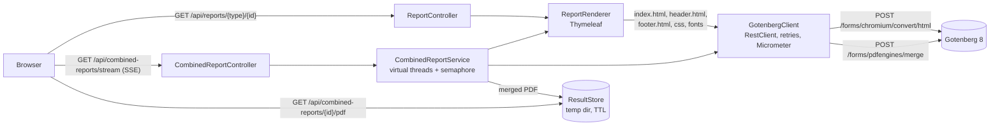

# spring-gotenberg-reports

PDF reports in Spring Boot without JasperReports. Templates are plain Thymeleaf HTML with a print
stylesheet. [Gotenberg](https://gotenberg.dev) (headless Chromium behind an HTTP API) turns them into
PDF. Long reports are split into sections, rendered in parallel and merged, and the browser follows
progress over Server-Sent Events.

All data in this repository is synthetic: fictional banks, invented names, `.example` e-mail domains.

## Why not JasperReports

JasperReports works, and plenty of systems run on it. These are the parts that hurt in day-to-day work:

- A report is a `.jrxml` file. It is XML in theory, but it is written by a designer tool, full of
  absolute coordinates, and a one-pixel move shows up as a wall of diff. Reviewing a layout change in a
  pull request is close to impossible, and merge conflicts get resolved by redoing the change.
- Layout lives in a proprietary designer (Jaspersoft Studio). Your team already knows HTML and CSS;
  few people know band types, `stretchType` and `positionType`.
- Fonts need font extensions packaged as jars, and a missing one fails at render time or, worse,
  silently falls back to another font with different metrics.
- Text that grows (long names, translations) overflows fixed-size boxes. HTML reflows.
- `.jasper` compiled files, report-scoped Java expressions, and a big library with its own
  dependency tree all live inside your application.

With HTML templates the report is ordinary source code. It renders in a browser while you work on it,
tests can assert on it, and the PDF engine runs as a separate process that can crash, restart or
scale on its own.

## Architecture



Choices and why:

- **Spring MVC on virtual threads** (`spring.threads.virtual.enabled=true`). The work is
  "render a string, upload it, wait for Chromium". With virtual threads that blocking code is cheap,
  stays easy to read and debug, and `SseEmitter` covers streaming. WebFlux would add a second
  programming model for no throughput gain at Gotenberg's scale (it converts at most 6 pages at once
  by default).
- **`RestClient` on the JDK `HttpClient`.** A blocked call is aborted when its thread is interrupted,
  so cancelling a job really stops its in-flight conversions.
- **Retries** use Spring Framework 7's `RetryTemplate` with exponential backoff. Only transport errors,
  429 and 5xx are retried. A 400 from Gotenberg means the request is wrong and is never retried.
- **Bounded concurrency** is a `Semaphore` around each section, one virtual thread per section.
- **Page size and margins** come from the template's `@page` rule (`preferCssPageSize=true`), so
  designers change them in CSS, not in Java.

Versions: Java 21 (bytecode level, `--release 21`), Spring Boot 4.1.1 (the newest stable release on
Maven Central when this was written; 4.2 is still at milestones), Spring Framework 7.0.9,
Thymeleaf 3.1.5, Testcontainers 2.0.5, JUnit 6, PDFBox 3.0.8, Maven 3.9.16 via the Maven Wrapper 3.3.4,
Gotenberg 8 (8.32.0 at the time of the measurements).

## Run it

With Docker only:

```sh
docker compose up --build
```

Then open <http://localhost:8080>. The page starts a combined report and shows its progress. Single
documents:

- <http://localhost:8080/api/reports/invoice/7>
- <http://localhost:8080/api/reports/statement/3>
- <http://localhost:8080/api/reports/portfolio-summary/12>
- add `?download=true` for `Content-Disposition: attachment`

Locally with a JDK 21 or newer, and Gotenberg in Docker:

```sh
docker run --rm -p 3000:3000 gotenberg/gotenberg:8
./mvnw spring-boot:run
```

Build and test:

```sh
./mvnw -B verify
```

`verify` runs the unit tests and then the integration tests (`*IT`) against a real
`gotenberg/gotenberg:8` container through Testcontainers. Without a reachable Docker daemon the
integration tests are reported as skipped and the build still passes.

## Endpoints

| Method and path | Result |
|---|---|
| `GET /api/reports/{type}/{id}` | One PDF, streamed from Gotenberg. `type` is `invoice`, `statement` or `portfolio-summary` (where `id` is the number of accounts). |
| `GET /preview/{type}/{id}` | The HTML that Gotenberg would print, viewable in a browser. |
| `GET /api/combined-reports/stream?accounts=12&concurrency=4` | Starts a combined report and streams SSE progress. |
| `GET /api/combined-reports/{jobId}/pdf` | Downloads a finished combined report (kept 15 minutes). |
| `GET /actuator/health`, `GET /actuator/metrics/gotenberg.requests` | Health (includes Gotenberg) and timers. |

Errors are RFC 9457 problem details: 400 for bad parameters, 404 for unknown report types,
502 when Gotenberg rejects or fails a document, 503 when it cannot be reached.

## The SSE protocol

`GET /api/combined-reports/stream` answers `text/event-stream`. Every event has a name and a JSON body:

```text
event:queued
data:{"jobId":"5cf54cb3-...","sections":5}

event:rendering
data:{"completed":1,"total":5,"section":"Account statement XX00 DEMO 0000 0002"}

event:merging
data:{"sections":5}

event:done
data:{"downloadUrl":"/api/combined-reports/5cf54cb3-.../pdf","bytes":322041,"elapsedMillis":595}
```

| Event | When | Data |
|---|---|---|
| `queued` | Job accepted | `jobId`, `sections` (accounts + 1 summary) |
| `rendering` | A section finished, in completion order | `completed`, `total`, `section` title |
| `merging` | All sections done, Gotenberg is merging | `sections` |
| `done` | Final. PDF is ready | `downloadUrl`, `bytes`, `elapsedMillis` |
| `failed` | Final. No PDF | `reason`, e.g. `timed out after 120.0 s` or the Gotenberg error |

The failure event is called `failed`, not `error`, because `EventSource` already fires `error` for
connection problems. The server also sends a `:keep-alive` comment every 5 seconds.

Cancellation: closing the connection cancels the job. Tomcat only notices a gone client when a write
fails, which is what the keep-alive comment is for. The job also stops when one section fails or when
`reports.combined.timeout` (2 minutes) expires. A cancelled job interrupts its threads, which aborts
the HTTP calls to Gotenberg, and deletes its temporary files.

The demo page closes the `EventSource` on its own `onerror` handler. Otherwise the browser would
reconnect and start a second job.

## Add a template

1. Create a record that implements `Report` (`template()`, `title()`, `filename()`). The record is the
   template model, so derived values such as totals or chart geometry are plain methods on it.
2. Add `src/main/resources/templates/reports/<template>.html`. Start from `invoice.html`: it pulls the
   `<head>`, letterhead and address block from `fragments.html`. Reference assets by bare file name
   (`report.css`), because Gotenberg receives all files in one flat directory.
3. Expose it in `SampleReports` (or your own controller) and open `/preview/<type>/<id>` in a browser
   while you work on the layout. The preview loads the same stylesheet and fonts as the PDF.
4. Shared print rules live in `report-assets/report.css`. Any `.css`, `.woff2`, `.svg` or `.png` in
   `report-assets/` is uploaded with every document.

Things worth knowing about Chromium printing:

- `thead { display: table-header-group }` repeats table headers on every page;
  `break-inside: avoid` keeps totals and charts in one piece.
- The running header and footer (`page-header.html`, `page-footer.html`) are rendered by Chromium in
  isolation. They cannot load stylesheets or web fonts, need explicit font sizes, and get page numbers
  through `<span class="pageNumber">` and `<span class="totalPages">`. The `@page` top and bottom
  margins are the space they get.
- Charts are inline SVG whose coordinates are computed in Java (`LineChart`, `BarChart`). No
  JavaScript runs, so there is no "wait until the chart has drawn" problem.
- The fonts are Noto Sans Regular and Bold as WOFF2 (SIL Open Font License, see
  `report-assets/OFL.txt`). The integration test checks that they end up embedded in the PDF.

## Observability

- `gotenberg.requests` timer, tags `operation` (`convert-html`, `merge`) and `outcome` (`success`,
  `client_error`, `server_error`, `io_error`, `cancelled`). It measures until the response headers
  arrive. Gotenberg only answers once the PDF is done, so that is the conversion time.
- `reports.combined` timer for whole jobs, tag `outcome` (`success`, `failed`, `cancelled`).
- Spring's own `http.client.requests` and `http.server.requests` metrics.
- Structured logs: set `LOGGING_STRUCTURED_FORMAT_CONSOLE=ecs` (docker compose does) to get one JSON
  object per line. Job logs carry `jobId` from the MDC plus key-value pairs such as `outcome` and
  `elapsedMs`.

## Performance notes

Measured with `bench/bench.sh` against `docker compose up` on one machine: AMD Ryzen 7 5800X3D
(8 cores, 16 threads), 125 GB RAM, Docker 29.9.1, Gotenberg 8.32.0 with its defaults
(`--chromium-max-concurrency=6`, Chromium restarted every 100 conversions). The app and Gotenberg
share the machine. Treat these as orders of magnitude, not a benchmark.

Single statement PDF (3 pages), 30 sequential requests after warm-up: median 0.20 s, p95 0.32 s.
An earlier run of the same script gave a median of 0.14 s, so expect that much noise.

Combined report with 24 statements plus a summary (25 sections, 83 pages, 1.2 MB), median of 5 runs:

| Concurrency | Median | Runs (ms) |
|---|---|---|
| 1 | 3.65 s | 3970 4030 3654 3585 3636 |
| 2 | 2.12 s | 2370 2121 2061 2114 2315 |
| 4 | 1.43 s | 1429 1293 1490 1653 1397 |
| 6 | 1.33 s | 1228 1265 1492 1396 1332 |
| 8 | 1.38 s | 1378 1514 1170 1393 1274 |

Over that session the mean Gotenberg conversion was 233 ms per section and the mean merge 37 ms.
One run with 200 accounts at concurrency 6 produced 684 pages (9.3 MB) in 11.8 s.

What the numbers say: parallelism pays off up to about 4 concurrent sections and flattens at 6, which
is Gotenberg's Chromium limit. Past that, requests just queue inside Gotenberg. To go faster, run more
Gotenberg replicas, not more threads. Runs with the same setting differ by about 30%
(1170 to 1514 ms at concurrency 8); I did not dig into the cause.

## Limitations

- Page numbers in a combined report restart in every section ("Page 1 of 3" per statement), because
  each section is printed separately. Global numbering would need a second pass, for example stamping
  numbers onto the merged PDF.
- Each section embeds its own font subset, so a merged PDF carries the fonts once per section. That is
  most of the 1.2 MB for 83 pages.
- Finished PDFs and job state live on local disk and in memory. With more than one app instance you
  need sticky sessions or shared storage (S3 or similar) and a shared job registry.
- No authentication. The actuator health endpoint shows details. Put both behind your usual security
  before exposing anything.
- The header and footer use whatever sans-serif font the Gotenberg image has, since Chromium does not
  load web fonts there.
- Chromium output is not PDF/A. Gotenberg can convert to PDF/A (`pdfa` form field); this project does
  not use it.

## Migrating from JasperReports

Advice, in the order that tends to work:

1. Inventory first. List every report with its parameters, data source and who uses it. Many turn out
   to be unused, or to be the same report with different filters.
2. Move data access out of the report. Jasper reports often run their own SQL. Build the model in Java
   (a record per report, like `Statement` here), test it on its own, then hand it to the template.
3. Port one report end to end, including fonts, page size and header/footer, before converting the rest.
   It settles the CSS conventions everyone else will copy.
4. Translate bands to HTML. Title band becomes the letterhead fragment, page header and footer become
   `header.html`/`footer.html`, the detail band becomes a table row, groups become nested loops, and
   summary bands become a block with `break-inside: avoid`.
5. Replace subreports with Thymeleaf fragments. Replace Jasper charts with SVG computed in Java, or a
   chart library that can render SVG server-side.
6. Compare old and new output with real (anonymised) data. Extract text with PDFBox and diff totals and
   key fields. Pixel-perfect equality is rarely worth chasing.
7. Run both side by side behind a flag per report, then delete the `.jrxml` files and the Jasper
   dependency.

## License

MIT, see [LICENSE](LICENSE). Copyright (c) 2026 Jean Carlo Benites Porras.

Noto Sans is licensed under the SIL Open Font License 1.1, see
[src/main/resources/report-assets/OFL.txt](src/main/resources/report-assets/OFL.txt).
